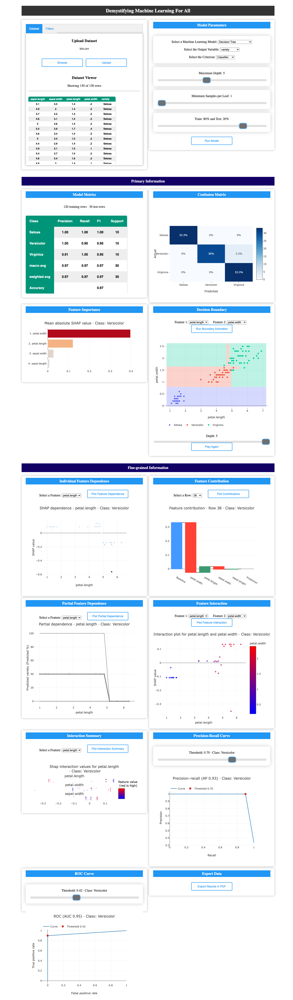

# DemystifyingAI

DemystifyingAI is a browser-based tool for exploring how machine learning models make predictions. Upload a CSV, choose a target and features, and compare Decision Tree, Random Forest, and Support Vector Machine (SVM) models for classification or regression.

## Run locally

Use Python 3.12. Create a virtual environment and install the dependencies once.

```sh
python3.12 -m venv .venv
source .venv/bin/activate
python -m pip install -r requirements.txt
```

On Windows with PowerShell, use `py -3.12 -m venv .venv` and `.\.venv\Scripts\Activate.ps1`, then run the same pip command.

Start the app from the repository root.

```sh
python run.py
```

Open [http://127.0.0.1:1407](http://127.0.0.1:1407). Waitress serves the frontend, its bundled assets, and the API from the same address. Use `python run.py --port 8080` to change the port. The default bind address is `127.0.0.1` and can be changed with `--host`.

Uploaded datasets and fitted models live in memory for the current browser session. A successful upload replaces that browser’s dataset and results. Restarting the server clears all workspaces. The server retains up to 16 recently used workspaces and is intended to run as a single process.

## Try a dataset

1. Select **Browse**, open a CSV from `testdataset/`, then select **Upload**.
2. Choose the target column and model. Use **Filters** to exclude features and set the training percentage with the split slider.
3. Select **Run Model**. The dashboard shows the number of training and test rows, evaluation metrics, and feature importance.
4. Explore the detailed plots. To inspect one prediction, plot feature dependence and click a point or select its row in **Feature Contribution**. Row IDs are zero-based across CSV data rows, excluding the header and blank lines.
5. Select **Export Results in PDF** to open the browser’s print dialog and save the displayed results as a PDF.

| Dataset | Target | Task |
| --- | --- | --- |
| [Iris](testdataset/iris.csv) | `variety` | Classification |
| [Shapes](testdataset/Shapes.csv) | `Shape` | Classification |
| [Alphabets](testdataset/Alphabets.csv) | `sketch` | Classification. Exclude `drop_this`. |
| [Housing](testdataset/Housing.csv) | `price` | Regression |

Use a comma-separated UTF-8 file with unique headers and at least two columns. Selected columns need complete, finite values. Regression requires a numeric target. Classification requires each class to appear in both the training and test sets. Text features are encoded using categories observed in training, with a separate code for unseen test categories. The upload request limit is 8 MiB, and the preview shows up to 200 rows.

Metrics, PR and ROC curves, and residuals use held-out test rows. PR and ROC use a one-vs-rest comparison for the class named in the chart. Classification SHAP and partial dependence charts name the class they explain. The decision boundary fits a separate classifier on the two selected numeric features. Tree models animate by depth, and SVM renders one boundary. SVM uses Kernel SHAP with up to 128 held-out rows and a sampled training background. Its pairwise SHAP interaction plots report sampled estimates. [Kernel SHAP documentation](https://shap.readthedocs.io/en/stable/generated/shap.KernelExplainer.html)

## Example

Iris classification with a Decision Tree, an 80/20 split, and a decision boundary using petal length and petal width.



## Bugs fixed

| Bug | Fix |
| --- | --- |
| Uploads overwrote a shared CSV, and re-uploading left duplicate filters and stale plots. | Validate CSVs before replacing the session dataset. Rebuild the filters and reset model results after an accepted upload. |
| CSV cells and headers were rendered as markup. | Render preview values, filter labels, and metrics as text. |
| The training slider was applied as the test fraction, and invalid settings could cause server errors. | Apply the training fraction as displayed, stratify classification splits, and return actionable validation errors. |
| The SVM option had no training handler. | Implement scaled SVM classification and regression, with evaluation, SHAP explanations, and a classifier boundary. |
| Some charts evaluated training rows, applied probability thresholds as percentages, or selected the wrong row contribution. | Evaluate holdout data, compute the exact `0–1` cutoff, and link contribution plots by CSV row ID. |
| Boundaries flattened multiclass predictions, and some charts required WebGL. | Draw a region and legend entry for each class with a bounded grid, and render interaction charts without WebGL. |
| Local setup required a separate frontend server and a hardcoded API address. | Serve both through `run.py` using same-origin requests and a single requirements file. |

## Verify changes

Run the API regression tests from the repository root.

```sh
python -m unittest discover -s tests
```
